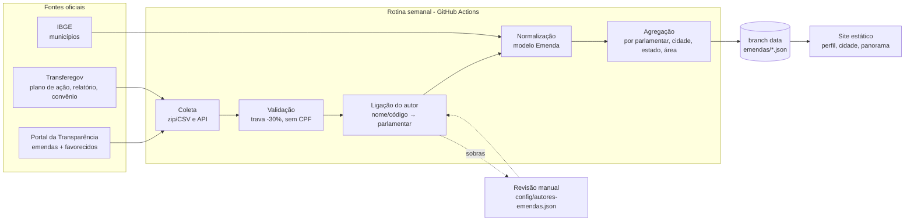

# Rastreio de Emendas Parlamentares

Status: **proposta** (aguardando aprovação). Fontes marcadas "a confirmar" dependem do spike E0.

## Objetivo
Responder, com dados oficiais e sem nota/ranking:
1. **Quanto** cada deputado e senador indicou em emendas, **para onde** (cidade/estado) e **em quê** (área).
2. **Quanto andou o dinheiro:** empenhado → liquidado → pago.
3. **Quem recebeu:** prefeitura, governo estadual ou entidade (CNPJ).
4. **Prestou contas?** Para "emenda Pix", se o ente apresentou plano de ação e relatório de gestão.

Fora do escopo: dizer se a obra ficou boa ou se houve desvio (não há dado nacional para isso); emendas de relator (RP9, sem autor identificado, extintas em 2022).

## Fases
| Fase | Entrega | Fonte | Status da fonte |
|---|---|---|---|
| E0 | Spike: baixar 1 vez cada fonte pelo GitHub Actions, medir tamanho, campos e qualidade | todas | — |
| E1 | Emendas por parlamentar (valores por etapa, destino, área) | Portal da Transparência (CGU) — download "Emendas parlamentares" | a confirmar no E0 |
| E2 | Quem recebeu (favorecido) + página por cidade | Portal da Transparência — arquivo de favorecidos/documentos da mesma base | a confirmar no E0 |
| E3 | Prestação de contas das emendas Pix e andamento de convênios | Transferegov (API de dados abertos de transferências especiais e convênios) | a confirmar no E0 |

## Fluxo



## Frequência
**Semanal** (domingo, depois da presença). Execução orçamentária muda devagar e os arquivos da CGU são grandes; diário não acrescenta informação. A rotina diária só lê o resultado mais recente.

## Modelo de dados
```ts
interface Emenda {
  id: string;                 // código oficial da emenda
  ano: number;
  tipo: "individual" | "bancada" | "comissao" | "outra";
  idParlamentar: string | null; // só individual, depois da ligação do autor
  autorTexto: string;         // como veio na fonte (auditoria)
  destino: { nivel: "municipio" | "estado" | "nacional"; ibge: string | null; uf: string | null; nome: string };
  area: string;               // função orçamentária (saúde, educação…)
  valores: { empenhado: number; liquidado: number; pago: number; restosPagos: number };
  modalidade: "pix" | "convenio" | "outra" | null; // E3
  urlFonte: string;
}
interface Favorecido {        // E2
  idEmenda: string;
  cnpj: string;               // só CNPJ; pessoa física é descartada
  nome: string;
  tipo: "prefeitura" | "estado" | "entidade" | "outro";
  valorPago: number;
}
interface PrestacaoContas {   // E3, só emenda Pix
  idEmenda: string;
  planoApresentado: boolean;
  relatorioApresentado: boolean;
  situacao: string | null;    // como vem do Transferegov
}
```

## Ligação autor → parlamentar
1. Código do autor da fonte, se bater com código conhecido (tabela de/para mantida em `config/autores-emendas.json`).
2. Nome normalizado (sem acento, sem "Dep."/"Sen.") + casa, com a mesma busca fonética já usada no site.
3. O que não ligar com certeza fica `idParlamentar: null`, entra num relatório de qualidade e é resolvido à mão uma única vez (o de/para fica salvo).
- Meta: ≥ 99% do valor das emendas individuais ligado. Abaixo disso, a rotina não publica (trava).

## Arquivos publicados (branch `data`)
| Arquivo | Uso | Tamanho estimado |
|---|---|---|
| `emendas/parlamentar/{id}.json` | resumo no perfil + lista das emendas | pequeno |
| `emendas/cidade/{ibge}.json` | página da cidade (E2) | pequeno |
| `emendas/resumo.json` | panorama: totais por estado, área, tipo, etapa | pequeno |
| `emendas/qualidade.json` | autores não ligados, linhas descartadas | pequeno |
Os CSVs brutos não são guardados (são re-baixáveis), como no resto do pipeline.

## Telas
- **Perfil:** bloco novo "Para onde mandou dinheiro?" — total indicado, barra empenhado/liquidado/pago, principais cidades e áreas, link "ver todas as emendas".
- **Página da cidade** (`/cidade/{ibge}`): "Quanto chegou de emenda para Aracaju, de quem e para quê" + status de prestação de contas (E3).
- **Panorama:** totais por estado e área, % pago sobre o empenhado; emendas Pix com e sem prestação de contas. Sem lista ordenada de parlamentares.
- Linguagem: "reservado / entregue / pago" no lugar de "empenhado / liquidado / pago", com glossário.

## Regras e travas
- Mesma trava do pipeline: queda > 30% em qualquer contagem bloqueia a publicação.
- Nunca persistir CPF (favorecido pessoa física é descartado, como nos gastos).
- Bancada e comissão aparecem separadas e nunca somadas no total de uma pessoa.
- Texto neutro: verificador de neutralidade passa a varrer `/cidade`.
- Valor de ano corrente sempre com aviso "ano em andamento".

## Custo
R$ 0: fontes públicas gratuitas; rotina no GitHub Actions (repositório público); páginas estáticas na Cloudflare. Impacto só no tempo da rotina semanal (estimativa a medir no E0).

## Riscos
| Risco | Mitigação |
|---|---|
| Formato/URL da CGU muda | Spike E0 documenta; coletor com teste por fixture; trava |
| Download grande ou bloqueado no Actions | Medir no E0; se preciso, só os anos 2023+ e cache semanal |
| Autor ligado errado | Ligação conservadora + revisão manual + meta de 99% |
| Dado do Transferegov incompleto | Mostrar "não informado" separado de "não prestou contas" |
| Leitura enviesada ("quem mandou mais") | Sem ranking; mostrar sempre etapa e destino |

## Ordem de execução (stories)
1. **E0 Spike de fontes** — 1 workflow manual que baixa e resume cada fonte (campos, linhas, tamanho). Saída anexada a esta página. *Decide se E1–E3 seguem como desenhado.*
2. **E1.1** Coletor CGU + modelo `Emenda` + testes com fixture.
3. **E1.2** Ligação de autores + relatório de qualidade.
4. **E1.3** Agregação + bloco no perfil + panorama.
5. **E2.1** Favorecidos + página da cidade.
6. **E3.1** Prestação de contas (Pix) e convênios.
